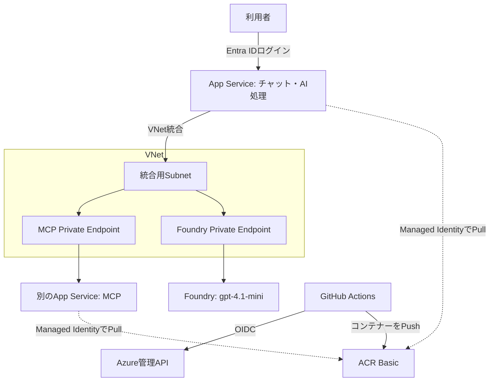

# App Serviceから非公開MCPとFoundryを使う

Entra IDでログインした利用者が、AIチャットから架空の商品と在庫を照会する検証環境です。Python製のフロントとMCPサーバーを別々のApp Serviceに配置し、TerraformとGitHub Actionsでデプロイします。

まずローカルでテストできます。Azureへの課金は発生しません。

```sh
uv sync --frozen
uv run pytest -q
```

18件のテストで、MCPの実HTTP通信、ツール実行、トークンの検証、呼び出し回数制限、削除対象の保護を確認します。Foundryの実モデルを使う検証はAzureデプロイ後に行います。

## 構成



- 2つのApp Serviceは、東日本のLinux B1プラン1台を共有します。
- フロントだけを公開します。MCPとFoundryの公開ネットワークアクセスは無効です。
- フロントはManaged IdentityでMCPとFoundryに接続します。MCPは専用audience、呼び出し元、`Mcp.Invoke`ロールを検証します。
- Easy AuthのログインにもManaged Identityのフェデレーションを使います。クライアントシークレットやモデルAPIキーを設定する必要はありません。
- Private DNS ZoneをVNetにリンクし、統合用とPrivate Endpoint用のSubnetを分けます。
- ACRとTerraform State用Storageは認証付きの公開エンドポイントを使います。GitHub-hosted Runnerから利用し、常設RunnerやVPNは作りません。

## Azureへデプロイする

必要なものはPython 3.12、uv、Terraform（[指定バージョン](.terraform-version)）、Azure CLI、GitHub CLIです。DockerはGitHub ActionsのRunnerで使用します。実行者には、Azureリソース・ロール割り当てと、Entraアプリ・アプリロール割り当てを作成できる権限が必要です。

1. このコードを自分の公開GitHubリポジトリに置き、mainを既定ブランチにします。
2. `az login --tenant TENANT_ID` と `gh auth login` を済ませ、利用するAzureサブスクリプションを選びます。
3. 自分のリポジトリ名でbootstrapを実行します。

   ```sh
   python scripts/manage.py bootstrap --repository OWNER/REPOSITORY
   ```

   初期State用Storage、Managed Identity、Entraアプリ、ロール、GitHub OIDC信頼を作り、必要なIDをGitHub Variablesへ設定します。ローカルの設定・bootstrap StateはGit対象外の `.local/` に置きます。**最初のbootstrap開始時に48時間後の期限を決め、再実行しても延長しません。**

4. mainへのアプリ・インフラ変更のPush、またはActionsの `Deploy` の手動実行でデプロイします。解説文だけの更新では再デプロイしません。

   ```sh
   gh workflow run deploy.yml --ref main
   ```

   Terraformのplan/apply → コンテナービルド・ACR Push → 2つのアプリを再起動 → 実環境の確認の順に実行します。初回はイメージの存在前にApp Serviceを作りますが、Push後の再起動と検証が成功するまでデプロイ成功とは扱いません。

5. App ServiceのフロントURLを開き、許可した本人でログインします。「商品ID PC001 の在庫は？」と質問すると、MCPの固定データである12台を根拠に回答します。画面には実際に呼んだツール名も表示されます。

## CI/CDで確認すること

`Validate` はAzure認証を使わず、テスト、lint、Terraformの構文、コンテナービルドを確認します。PRのコードにはAzureの権限を渡しません。

`Deploy` はmainのOIDCトークンだけを信頼します。フロントは起動時に自分のManaged Identityで内部検証を実行し、公開の `/health` には成功フラグとコミットSHAだけを返します。ヘルスチェックを何回呼んでも追加の推論は実行しません。

- MCPとFoundryの名前がVNetのPrivate IPに解決される。
- MCPがトークンなし・宛先違いのトークンを拒否する。
- FoundryがMCPの在庫ツールを呼び、結果を使って回答する。
- 未ログインのフロントアクセスはログインへ転送される。
- 外部からMCPへはアクセスできず、Foundryの公開アクセス・キー認証も無効になっている。
- デプロイ直後のTerraform planに差分がない。

ブラウザでのログイン成功は別に確認し、自動テストだけで検証済みとは記録しません。

## 削除する

検証後は `Cleanup` を手動実行します。`confirm_prefix` にbootstrapで表示された `azmcp` から始まる環境名を指定してください。

```sh
gh workflow run cleanup.yml --ref main -f confirm_prefix=azmcpXXXXXX
```

削除忘れに備え、毎時17分に期限を確認し、48時間を過ぎた環境を自動削除します。GitHubのスケジュールは遅れる場合があるため、厳密な48時間の停止保証ではありません。成功を確認してください。

Cleanupは対象名と所有タグを確認してから、ワークロードをTerraformで削除します。続いて今回のEntraアプリとbootstrapリソースグループも削除し、State用Storageや課金されるプランを残しません。Terraformの削除が失敗した場合も、確認済みの検証用グループに限定して削除します。終了後はDeploy/Cleanupの両Workflowを無効化し、無効なAzure認証での定期実行を止めます。

再検証は新しい作業コピーでbootstrapから開始し、Workflowを有効化してください。検証記録とコードを削除する処理はありません。

## 費用と制限

48時間・少量利用で総額500〜800円を目安にしています。[費用概算と前提](docs/cost-estimate.md)を確認してください。1,000円のハードリミットを保証する仕組みではありません。

チャットは1プロセスで同時に1件、1分に5件、起動から100件までです。1質問につき最大4回のモデル推論と4回のツール実行、推論出力は各400 tokensです。カウンターは再起動でリセットされます。起動時の検証も少量の推論を使います。デモは本人だけに制限し、費用は実際の使用量でも確認します。

会話履歴の保存、購入・更新操作、独自ドメイン、可用性の保証は初期範囲に含めません。B1のCPUとメモリは2アプリで共有します。

## 解説と検証記録

- [合意した要件](docs/requirements.md)
- [設計と認証の解説](docs/architecture.md)
- [検証記録](docs/verification.md)
- [ブログの下書き](docs/blog-draft.md)
