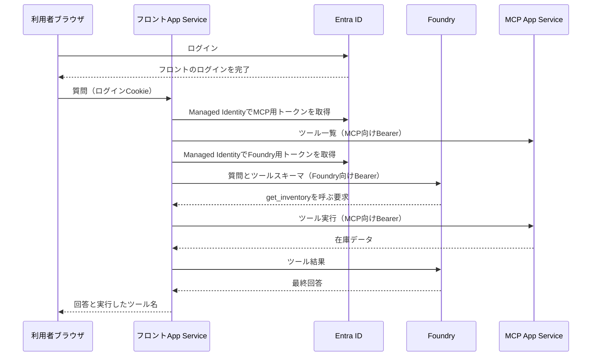

# 設計と認証の解説

## なぜフロントにサーバー側のAI処理を置くか

ブラウザはチャット画面を表示し、同じApp Serviceの `/api/chat` を呼びます。FoundryとMCPを呼ぶのはApp Service上のPythonです。Managed Identityで取得したアクセストークンをブラウザへ渡す必要がなく、MCPのPrivate Endpointにもブラウザから直接到達する必要がありません。

モデルはMCPプロトコルを直接操作しません。フロントがMCP SDKでツール一覧を取得し、FoundryのChat Completions APIに関数のスキーマとして渡します。モデルから返った関数呼び出しをMCPの `tools/call` に変換し、取得結果をモデルに渡して最終回答を作ります。

## 認証と認可を分ける

利用者のログインにはEasy Authを使います。単一テナントのアプリ登録、検証者へのユーザーロール割り当て、Easy Authの許可ユーザー設定で入口を制限します。App Serviceからアプリに渡される検証済みのユーザーIDもフロントで確認します。

フロントからMCPへの呼び出しには、フロント専用のUser Assigned Managed Identityを使います。MCP用のアプリ登録に `Mcp.Invoke` というApplicationロールを定義し、このIDだけに割り当てます。

MCPではEasy Authの検証に加え、PythonでもJWTの署名・発行元・有効期限・audience・テナント・呼び出し元・ロールを確認します。`api://MCP_CLIENT_ID/.default` はMCP向けトークンを取得するscopeです。v2のアクセストークンのaudienceはMCPのclient IDです。Foundry用のトークンをMCPへ送っても拒否されます。

利用者のトークンはMCPに転送しません。MCPが確認する権限はフロントというアプリの権限です。ユーザーごとの下流権限が必要な場合は、On-Behalf-Of等を使う別の設計になります。

## Easy Authのクライアントシークレットを減らす

ログインの認可コード交換にもフロントのManaged Identityを使います。Entraアプリに、このIDのobject IDをsubjectにしたFederated Identity Credentialを設定します。

App Serviceには `OVERRIDE_USE_MI_FIC_ASSERTION_CLIENTID` を設定し、値にはManaged Identityのclient IDを入れます。Easy Authの `client_secret_setting_name` はこの設定名を参照します。名前にはsecretが含まれますが、保存する値は秘密の文字列ではなくclient IDです。このIDはフロントのApp Serviceだけに割り当てます。[Microsoftの設定手順](https://learn.microsoft.com/en-us/azure/app-service/configure-authentication-provider-aad#use-a-managed-identity-instead-of-a-secret)

## VNetの役割

VNet統合はApp Serviceの外向き通信のための機能です。MCPを内向きに非公開化するためにはPrivate Endpointと公開アクセスの無効化も必要です。[VNet統合](https://learn.microsoft.com/en-us/azure/app-service/overview-vnet-integration)、[Private Endpoint](https://learn.microsoft.com/en-us/azure/app-service/overview-private-endpoint)

`10.42.1.0/26` をApp Service統合用、`10.42.2.0/24` をPrivate Endpoint用にします。MCPとFoundryの名前をPrivate DNSでPrivate IPに解決し、フロントからそのIPへ接続します。App Service自体をVNetのSubnetへ配置する構成ではありません。

ACR、State用Storage、Entra ID、Azure管理API、GitHubの各エンドポイントは公開経路を利用します。MCPとFoundryのデータAPIを非公開にする要件と、すべての外向き通信を閉域化する要件は異なります。今回は前者を対象にします。

## Terraformを2つに分ける理由

`infra/bootstrap` はローカルの管理者で最初に実行します。State用Storage、Managed Identity、Entraアプリ、アプリロール、GitHub OIDC信頼を作ります。初期StateはGit対象外のローカルファイルです。

`infra/workload` はGitHub Actionsから実行します。ネットワーク、App Service、Foundry、モデル、ACR、Azure RBACを管理し、StateをStorageに置きます。App Serviceの実際のホスト名で決まるログインのRedirect URIもこのStackで管理します。

デプロイ用IDのAzure権限は、この検証用リソースグループへのContributorとRBAC管理、bootstrapグループへのContributor、StateへのBlobアクセスに限定します。Entraには `Application.ReadWrite.OwnedBy` を付与し、デプロイ用IDが所有する今回の2アプリのRedirect URI更新・削除に使います。テナント内の全アプリを変更できる権限は付与しません。

StateにはProviderが取得する秘密情報が含まれる可能性があるため、Gitや公開Artifactへ保存しません。StorageはOAuth認証を使い、共有キー認証とBlobの匿名公開を無効にします。

## 非公開App ServiceへCI/CDする

通常のソースデプロイはSCM/Kuduへの到達性も必要です。今回はコンテナーにして、GitHub ActionsからACRへPushし、Azure管理APIで設定したイメージをApp Serviceが取得する方式にします。これで非公開MCPのSCMへRunnerが直接接続する必要を省きます。App ServiceによるACR取得もManaged Identityを使います。[コンテナーとManaged Identity](https://learn.microsoft.com/en-us/azure/app-service/configure-custom-container)

デプロイ用IDが実行時のMCPロールを使うことはありません。フロントの起動時にフロント自身のIDで検証を実行し、CIはその結果だけを確認します。内部の検証を外部から何度も起動できるAPIは作りません。
