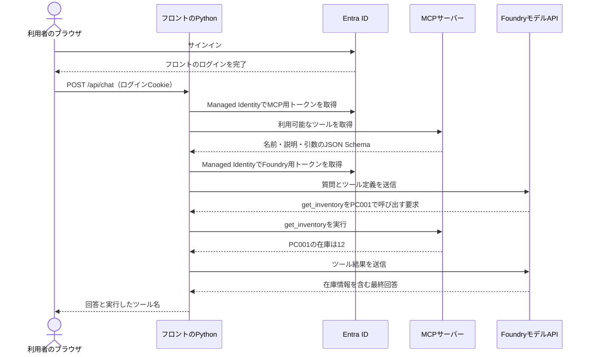
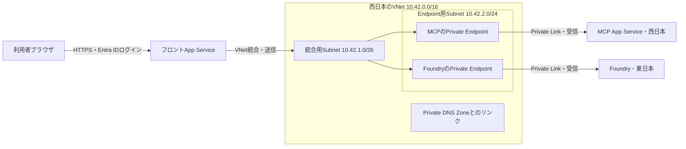
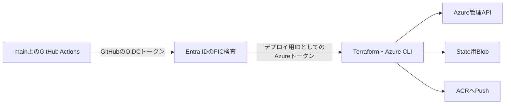

# Pythonから理解する、App Service・Entra ID・非公開MCP・Foundry・Terraformの構成

Pythonの関数、`async` / `await`、JSONはある程度分かる一方、Azure・ネットワーク・IaCはこれから学ぶ方に向けた解説です。今回作ったコードと、実際の検証結果を対応させて説明します。

検証では、Entra IDでログインした利用者が「商品ID PC001 の在庫は？」と質問し、AIがMCPの在庫照会ツールを使って回答するところまで確認しました。実AzureでのCI/CDも成功しています。その後、費用を止めるため環境を削除しました。

**2026年11月8日21:37 JSTの再確認でも、検証用の2つのリソースグループは存在せず、関連する実リソース・Entraアプリ・サービスプリンシパルは0件でした。AzureへのDeployとCleanupも無効のままです。** 再確認の元データは[cleanup-recheck.json](evidence/cleanup-recheck.json)にあります。この記事を作成するための確認では、環境を再作成していません。

コード全体は[GitHubリポジトリ](https://github.com/kazu-dota/azure-mcp-appservice)、実施済みと未検証の区別は[検証記録](verification.md)を参照してください。本文中の短いコードは、実装からの抜粋または理解のための簡略化です。再構築の手順は[README](../README.md)に分けています。

コードの説明はGitHubへ保存した版に基づきます。特にログイン設定は、[IDトークン発行を有効にした保存版のbootstrap](https://github.com/kazu-dota/azure-mcp-appservice/blob/b39aec3/infra/bootstrap/main.tf)を参照してください。

最初から読む場合は、1〜4章でPythonの処理をつかみ、5章でネットワーク、6〜7章で認証とモデル、8〜10章でTerraformと配置方法へ進みます。11章以降は、検証・障害調査・費用と削除の記録です。

## 1. 最初に、何を作ったのか

利用者から見ると、ブラウザに表示される小さなAIチャットです。しかし、裏では3つのプログラムが役割を分担しています。

| 動く場所 | 担当する処理 | 今回の実装 |
| --- | --- | --- |
| フロント用App Service | HTMLの配信、質問の受付、AIとMCPの呼び出し | FastAPIとPythonのAI処理 |
| MCP用App Service | 商品検索・在庫照会ツールの提供 | FastAPIとMCP Python SDK |
| FoundryのモデルAPI | 質問を読み、必要なツールを選び、結果から文章を作る | gpt-4.1-mini |

フロントには、画面だけでなくサーバー側のPythonも置きました。ブラウザが直接FoundryやMCPへ接続する設計ではありません。ブラウザから呼ぶ先は、フロント用App Serviceの `/api/chat` です。

MCPのデータはPythonの固定データです。`PC001` の在庫は12です。データベースや外部の在庫システムを追加せず、通信と認証に集中できる題材にしました。購入や在庫更新の機能はありません。

## 2. Azureの名前を、今回の用途に結び付ける

### サブスクリプションとテナント

**Azureサブスクリプション**は、Azureリソースを作成・管理し、利用料金を集計する単位です。今回のApp ServiceやStorageは、利用する個人のサブスクリプションに作りました。

**Entra IDテナント**は、ユーザーやアプリのIDを管理するディレクトリです。誰がログインしたか、どのアプリにどの権限を与えるかを扱います。

この2つは同じものではありません。Azureリソースを作る権限があっても、Entraのアプリ登録や権限付与ができるとは限りません。今回は実行者のAzure側のOwner権限とEntra側の管理権限を、それぞれ確認しました。

### リソースとリソースグループ

**リソース**は、App Service、仮想ネットワーク、Storageなど、個別に作成・設定・削除できる対象です。**リソースグループ**は、それらをまとめて管理する単位です。

今回は次の2グループを使いました。

| グループ | 中に置いたもの | 分けた理由 |
| --- | --- | --- |
| `azmcp4458ae-bootstrap` | Terraform State用Storage、Managed Identityなど | CI/CDを開始する前に必要になるものを先に作る |
| `azmcp4458ae-workload` | App Service、VNet、Private Endpoint、Foundry、ACRなど | アプリ本体の環境をCI/CDで作成・変更する |

リソースグループはネットワークの境界ではありません。同じグループに入れただけで通信できたり、外部アクセスが遮断されたりはしません。通信経路と認証は、それぞれ別に設定します。

また、Entraのアプリ登録はAzureのリソースグループに入るリソースではありません。そのため、リソースグループの削除とは別に、今回作ったアプリ登録も削除しました。

### App ServiceとApp Serviceプラン

**App Service**は、WebアプリやAPIを実行するAzureのサービスです。今回のPythonは、Uvicornを起動したコンテナーとして動かしました。自分でVMのOSを構築する代わりに、アプリの配置と設定を中心に扱えます。

**App Serviceプラン**は、そのアプリを動かすCPU・メモリ・台数・料金階層などを決めます。今回はLinux B1プラン1台を、フロントとMCPの2アプリで共有しました。アプリは別々ですが、計算資源は共有するので、負荷や障害の影響も考える必要があります。[App Serviceプランの公式説明](https://learn.microsoft.com/en-us/azure/app-service/overview-hosting-plans)

この区別は削除時にも関係します。アプリを停止・削除しても、プランが残ればプランの料金は続きます。今回、費用を止めるためにプラン自体も削除したのはそのためです。[App Serviceの費用管理](https://learn.microsoft.com/en-us/azure/app-service/overview-manage-costs)

### リージョン

**リージョン**は、Azureリソースを配置する地域です。今回はApp Serviceとネットワークを西日本、Foundry・ACR・State用Storageを東日本に置きました。

当初は東日本を考えましたが、対象サブスクリプションのApp Service B1割り当てが0でした。西日本で実際にB1プランを作成できたため、アプリ側を西日本に切り替えました。権限があること、サービスが地域で提供されていること、自分の割り当てに空きがあることは別々の条件です。

リソースグループの所在地が東日本でも、そこに入れる全リソースが東日本になるわけではありません。各リソースの `location` が実際の配置を決めます。

## 3. 1つの質問が回答になるまで

「商品ID PC001 の在庫を確認してください」という質問を例に、処理をたどります。



ここで実際にHTTPリクエストを送っているのは、フロントのPythonです。モデルは「この関数を、この引数で呼んでほしい」というデータを返します。Pythonがその要求を確認し、MCPの呼び出しに変換します。

この仕組みを実装したのが[app/agent.py](../app/agent.py)です。中心部分を簡略化すると、次のようなループです。

```python
# 概念を示す簡略例。実装では認証、スキーマ変換、回数制限なども行う。
tools = await mcp_client.list_tools()
messages = [user_message]

for _ in range(4):
    response = await call_model(messages, tools)
    if not response.tool_calls:
        return response.answer

    messages.append(response.assistant_message)
    for tool_call in response.tool_calls:
        result = await mcp_client.call_tool(tool_call.name, tool_call.arguments)
        messages.append(tool_result_message(tool_call.id, result))
```

今回、Foundry Agent Serviceにこのループを任せたわけではありません。Foundryから提供されるモデルAPIを使い、ツール実行の制御はフロントのPythonに実装しました。

## 4. MCPを、Pythonの関数から理解する

MCPは、クライアントとサーバーがツールなどをやり取りするためのプロトコルです。今回のMCPサーバーは、次の2つのツールを公開します。

| ツール | 引数 | 戻り値の内容 |
| --- | --- | --- |
| `search_products` | 検索キーワード | 商品ID、名前、カテゴリ、価格の一覧 |
| `get_inventory` | 商品ID | 商品の有無、名前、在庫数 |

Pythonの関数に、入力の型と説明を付けて登録したものだと考えると理解しやすくなります。[app/mcp_server.py](../app/mcp_server.py)では、MCP SDKのデコレーターを使っています。

```python
# 実装の構造を示す抜粋
@server.tool(annotations=read_only, structured_output=True)
def get_inventory(
    product_id: Annotated[str, Field(pattern=r"^[A-Z]{2}[0-9]{3}$")],
) -> InventoryResult:
    ...
```

`product_id` の入力には、英大文字2文字と数字3文字という形式を指定しました。戻り値はPydanticモデルで構造化します。クライアントはツール一覧から名前・説明・引数のスキーマを受け取り、それをモデルAPIの関数定義に変換します。

ツール一覧の取得とツール実行は、MCPでは `tools/list` と `tools/call` という操作に対応します。今回の接続はネットワーク越しなので、SDKのStreamable HTTPトランスポートを使いました。通常のHTTP APIの上で、MCPのメッセージをやり取りします。[MCPのTools仕様](https://modelcontextprotocol.io/specification/latest/server/tools)

`readOnlyHint` などの注釈は、そのツールの性質を伝える情報です。注釈自体が更新操作を禁止してくれるわけではありません。今回は関数の中身を読み取り専用にし、モデルが指定できる関数名も、サーバーから取得したツール一覧に限定しています。

サーバーは `stateless_http=True` とし、MCPのHTTP通信で永続セッションを前提にしない形にしました。また、モデルへ渡す `messages` は質問の処理ごとに作り直します。画面に過去のやり取りが表示されていても、サーバーが過去の会話をモデルへ毎回送る実装ではありません。後述するTerraformのStateは、これらの会話やMCPセッションとは別の記録です。

## 5. ネットワークで解決したい問題

Pythonで次のように書くとします。

```python
await http.post("https://demo-mcp.azurewebsites.net/mcp", json=message)
```

この1行が成功するには、少なくとも次の条件が必要です。

1. ホスト名を接続先のIPアドレスへ変換できる。
2. そのIPアドレスまで通信できる経路がある。
3. HTTPSの接続が成立する。
4. HTTPの認証と権限の検査を通る。

たとえば、認証トークンが正しくても、接続先への経路がなければタイムアウトします。反対に、通信できてもトークンがなければ認証で拒否されます。今回、ネットワークとEntra IDの両方を設定した理由です。

### IPアドレス、ポート、DNS

**IPアドレス**は、通信先や通信元を表すアドレスです。**ポート番号**は、その接続先で利用するサービスを区別します。今回、外部のHTTPS通信は443、コンテナー内のUvicornは8000を使います。ブラウザがコンテナーの8000番へ直接接続するわけではなく、App Serviceの入口がHTTPSを受け付け、コンテナーへ渡します。

**DNS**は、`demo-mcp.azurewebsites.net` のような名前からIPアドレスを調べる仕組みです。URLの文字列が同じでも、名前を調べるネットワーク環境によって、得られるIPアドレスは変わり得ます。今回の非公開接続では、この点が重要になります。

### VNetとSubnet

**VNet（Virtual Network）**は、Azure上に作る仮想ネットワークです。**Subnet（サブネット）**は、そのアドレス範囲を用途ごとに分割したものです。

今回の設定は[infra/workload/main.tf](../infra/workload/main.tf)にあります。

| 用途 | アドレス範囲 | この構成で置くもの・使い道 |
| --- | --- | --- |
| VNet全体 | `10.42.0.0/16` | 今回のネットワーク全体の範囲 |
| App Service統合用Subnet | `10.42.1.0/26` | フロントの送信通信をVNetへ接続する |
| Private Endpoint用Subnet | `10.42.2.0/24` | MCPとFoundryの非公開の接続口を作る |

`/16`、`/26`、`/24` はCIDRというアドレス範囲の表記です。IPv4は32ビットなので、`/26` なら残り6ビット、つまり64個分のアドレスを含む範囲を表します。すべてをアプリ用に使えるわけではなく、Azureが予約するアドレスもあります。まずは「範囲の大きさと境界を指定している」と捉えてください。

これらの `10.x.x.x` はプライベートアドレスです。自宅のブラウザから、単に `10.42.2.x` を指定すれば接続できる、というものではありません。今回そのネットワークへの経路を持つのは、VNet統合を設定したフロントのApp Serviceです。

### VNet統合は、フロントから外へ出るために使う

通常のApp Serviceに**VNet統合**を設定すると、アプリからVNet内の接続先へ通信できるようになります。今回では、フロントからMCPとFoundryのPrivate Endpointへ進むために使います。[App ServiceのVNet統合](https://learn.microsoft.com/en-us/azure/app-service/overview-vnet-integration)

Terraformでは、フロントの `virtual_network_subnet_id` に統合用Subnetを指定します。このSubnetは `Microsoft.Web/serverFarms` に委任します。委任とは、そのSubnetをApp Serviceの統合機能が使うことをAzureへ指定する設定です。

VNet統合を付けても、フロントへのインターネットからのアクセスが自動で非公開になるわけではありません。今回は利用者がフロントを開けることが必要なので、フロントの入口は公開し、Entra IDログインを必須にしています。

### Private Endpointは、MCP・Foundryへ入るために使う

**Private Endpoint**は、Azureサービスに対し、自分のVNet内のプライベートIPを持つ接続口を作る機能です。サービス全体をSubnetへ移す設定ではありません。[App ServiceのPrivate Endpoint](https://learn.microsoft.com/en-us/azure/app-service/overview-private-endpoint)

今回の通信経路は、次のようになります。



図では、App Service自体をVNetの箱の外に描いています。今回の通常のApp Serviceは、VMのようにSubnetへ直接配置する方式ではないからです。VNet内に作るのは、統合のための接続とPrivate Endpointです。

MCPとFoundryにはPrivate Endpointを作るだけでなく、**公開ネットワークアクセスも無効化**しました。非公開の入口を追加しても、元の公開入口が有効なら、ネットワーク全体を非公開にしたことにはならないためです。

統合用SubnetとPrivate Endpoint用Subnetは分けます。また、Private EndpointはVNetのリージョンに配置し、その接続先サービスは別リージョンでも利用できます。今回、東日本のFoundryへ、西日本のVNetのPrivate Endpointから接続したのはこの形です。[Private Endpointの基本](https://learn.microsoft.com/en-us/azure/private-link/private-endpoint-overview)

### Private DNSが、名前と非公開の接続先を結び付ける

Pythonのコードには通常のホスト名を使います。Private EndpointのIPを直接コードに書く方法は採りません。ホスト名はHTTPSの証明書や接続先の識別にも関わるためです。

今回、次のPrivate DNS Zoneを作り、VNetへリンクしました。

```text
privatelink.azurewebsites.net
privatelink.openai.azure.com
privatelink.services.ai.azure.com
privatelink.cognitiveservices.azure.com
```

Private DNS Zoneは、特定のドメインについて非公開でDNSレコードを管理するものです。**VNetへのリンク**は、そのVNetからこのZoneを名前解決に使えるようにします。Private Endpoint側の**DNS Zone Group**は、接続先に必要なレコードをそのZoneに登録・管理するための設定です。この2つは役割が違います。

今回の内訳はMCP用1 ZoneとFoundry用3 Zoneです。Foundryは `AIServices` として作り、関連する複数のサービス用ドメインをEndpointへ関連付けました。Pythonのモデル推論で実際に使っているホスト名は `openai.azure.com` 側です。

MCPの場合、概念的には次のように解決されます。

```text
通常のホスト名
  demo-mcp.azurewebsites.net
    ↓ CNAMEなどの参照
  demo-mcp.privatelink.azurewebsites.net
    ↓ VNetにリンクしたPrivate DNS ZoneのAレコード
  10.42.2.x
```

`10.42.2.x` は説明用の表記で、実際のIPを示すものではありません。フロントからこの名前を調べると、VNet内のIPへ解決され、そのIPへの通信はVNet統合を通ります。外部の端末には同じ私設DNSと経路がなく、公開アクセスも無効です。[App ServiceのPrivate DNS設定](https://learn.microsoft.com/en-us/azure/app-service/overview-private-endpoint#dns)

### NSGと、この構成で公開経路を使う通信

**NSG（Network Security Group）**は、IP・ポート・方向などで通信の許可・拒否を設定するものです。今回、統合用SubnetにNSGを関連付けましたが、独自の厳格な送信先制限は追加していません。NSGを作ったことと、特定の送信先だけへ通信を制限したことは別です。

また、すべての通信をVNetへ流す設定にはしていません。Entra ID、Azure管理API、ACR、State用Storageなどへの認証付きの公開通信は利用します。MCP側のJWT検証でEntraの公開鍵を取得する通信も必要です。今回、非公開にした対象はMCPとFoundryのデータAPIです。

そのため、本人が使うブラウザやGitHub-hosted Runner（GitHubが用意するCI/CDの実行環境）にVPNを追加する必要はありません。ブラウザは公開フロントへ、Runnerは公開のAzure管理APIとACR・Storageへ接続します。非公開のMCPを呼ぶ処理は、VNetへ接続できるフロント側で実行します。

## 6. 認証と認可を、通信経路ごとに分ける

**認証**は「誰が呼んでいるか」を確認する処理です。**認可**は「その呼び出し元に、その操作を許可するか」を判断する処理です。

今回、Entra IDを使う経路は主に次の3つです。

| 通信 | 確認するID | 利用を許可する設定 |
| --- | --- | --- |
| 利用者 → フロント | サインインした本人のユーザーID | ユーザーへのアプリロール割り当て、Easy AuthとPythonの許可ユーザー確認 |
| フロント → MCP | フロントのManaged Identity | MCP専用のアプリロール `Mcp.Invoke`、呼び出し元IDなどの検証 |
| フロント → Foundry | フロントのManaged Identity | Azure RBACの `Cognitive Services OpenAI User` |

下流のMCPは「どの利用者が質問したか」ではなく、「許可したフロントアプリが呼んでいるか」を確認します。利用者のトークンは下流へ転送していません。ユーザーごとにMCPの操作権限を分ける場合は、別の権限設計が必要になります。

### 利用者のログインはEasy Authへ任せる

**Easy Auth**は、App Serviceに組み込まれた認証機能です。アプリの手前でログイン処理を扱い、認証済みの情報をアプリへ渡します。[App Serviceの組み込み認証](https://learn.microsoft.com/en-us/azure/app-service/overview-authentication-authorization)

今回の流れは次のとおりです。

1. 利用者がフロントのURLを開く。
2. 未ログインならEntra IDの認証画面へ移る。
3. Entra IDで本人を認証する。必要に応じて多要素認証も行う。
4. App Serviceの `/.auth/login/aad/callback` へ戻る。
5. Easy Authがログインセッションを確立する。
6. ブラウザはセッションCookieを付けて画面や `/api/chat` を呼ぶ。

FastAPI側はパスワードを受け取りません。[app/frontend.py](../app/frontend.py)では、Easy Authが渡す `X-MS-CLIENT-PRINCIPAL-ID` を許可したユーザーのobject IDと比較します。

このヘッダーを信頼できるのは、本番の入口でEasy Authを有効にし、利用者が送った同名のヘッダーをそのまま採用しないApp Serviceの仕組みを前提にしているためです。FastAPI単体で任意のヘッダーを受け取る構成に移すなら、同じ前提は使えません。[認証済みユーザー情報の取得](https://learn.microsoft.com/en-us/azure/app-service/configure-authentication-user-identities)

今回の対象は単一テナントで、許可した本人だけです。個人のMicrosoftアカウントでAzureを使う場合でも、ここで照合するのは対象テナント内のユーザーIDです。

### アプリ登録とサービスプリンシパル

**アプリ登録（Application）**では、ログインに使うアプリの設定や、APIが公開するロールなどを定義します。**サービスプリンシパル（Service Principal）**は、そのテナントでアプリに権限を与える対象となるIDです。

今回、フロントのログイン用アプリ登録と、MCP API用アプリ登録を分けました。ログイン先を識別する設定と、MCPが受け付けるAPIトークンの宛先・権限を別に管理するためです。

なお、Managed Identityにもサービスプリンシパルがありますが、通常のアプリ登録と同じApplicationオブジェクトが作られるわけではありません。この違いは、権限を付与する対象を探すときに関係します。[ApplicationとService Principalの関係](https://learn.microsoft.com/en-us/entra/identity-platform/app-objects-and-service-principals)

### Managed Identityは、Azure上のプログラムのID

**Managed Identity**は、Azureが資格情報を管理する、プログラム用のIDです。今回のPythonは、IDのclient IDを指定してトークンを取得します。

```python
from azure.identity.aio import ManagedIdentityCredential

async with ManagedIdentityCredential(client_id=frontend_identity_client_id) as credential:
    token = await credential.get_token("api://MCP_CLIENT_ID/.default")
```

`client_id` は識別子であり、パスワードではありません。ただし、IDが存在するだけで呼び出しが許可されるわけではありません。アプリへIDを割り当て、そのIDにMCPのアプリロールやFoundryのAzure RBACロールを付与して初めて、必要な操作が可能になります。

今回のIDを用途別に整理すると、次のようになります。

| ID・登録 | 主な用途 |
| --- | --- |
| フロントのログイン用アプリ登録 | 利用者がどのアプリへサインインするかを定義する |
| MCP API用アプリ登録 | MCP向けトークンの宛先と `Mcp.Invoke` ロールを定義する |
| フロントのUser Assigned Managed Identity | MCP・Foundryを呼ぶ、ACRからイメージを取得する、ログイン時のアプリ認証にも使う |
| MCPのUser Assigned Managed Identity | ACRからイメージを取得する |
| デプロイ用User Assigned Managed Identity | GitHub ActionsからAzureを構成する |
| FoundryのSystem Assigned Managed Identity | 今回有効にしたFoundryのproject management設定に必要な、Foundry自身のID |

**User Assigned**はIDを独立したAzureリソースとして作り、利用先へ割り当てる方式です。**System Assigned**は対象リソースに結び付いたIDです。今回のフロントがFoundryを呼ぶIDと、Foundry自身のIDは別です。

また、IDの名前が似ていても次の値を取り違えないようにします。

| 値 | 今回の使い道 |
| --- | --- |
| tenant ID | 認証を行うディレクトリを指定する |
| アプリ登録のclient ID | ログイン先やMCP向けトークンの宛先を識別する |
| Managed Identityのclient ID | PythonやApp Serviceで使用するManaged Identityを選ぶ |
| Managed Identityのprincipal ID / object ID | ロール付与や「どのIDからの呼び出しか」の照合に使う |
| アプリ登録のobject ID | Microsoft GraphやTerraformで、その登録オブジェクトを更新・削除する |

アプリ登録にもサービスプリンシパルにもobject IDがあります。「object ID」とだけ書かれた値を使う際は、どの種類のオブジェクトのIDかを確認します。[Managed Identityの用語](https://learn.microsoft.com/en-us/entra/identity/managed-identities-azure-resources/managed-identities-glossary)

### MCPへ渡すアクセストークン

フロントはMCPへ、次の形のHTTPヘッダーを付けて接続します。

```text
Authorization: Bearer <MCP向けのアクセストークン>
```

ここで使うのは、APIを利用するための**アクセストークン**です。ユーザーがログインしたことをアプリへ伝える**IDトークン**とは用途が異なります。

アクセストークンには、有効期限、発行元、宛先、呼び出し元、権限などの情報が含まれます。[app/auth.py](../app/auth.py)では、主に次を検査しています。

| 検査 | 調べる内容 |
| --- | --- |
| 署名 | Entra IDが署名したトークンとして検証できるか |
| `iss` | 期待したテナントの発行元か |
| `aud` | このMCP API向けのトークンか |
| `exp` / `iat` | 有効期限や必要な発行時刻情報が正しいか |
| `tid` | 期待したテナントか |
| `azp` または `appid` | 許可したクライアントIDからの呼び出しか |
| `oid` | 許可したフロントのサービスプリンシパルか |
| `roles` | `Mcp.Invoke` が含まれているか |

**JWT（JSON Web Token）**は、ヘッダー・本文・署名からなるトークンの形式です。内容をBase64URLで読み出せただけでは正当なトークンとはいえません。署名と各種の条件を検証する必要があります。実装では、検証用公開鍵の一覧である**JWKS**からEntra IDの公開鍵を取得し、署名アルゴリズムも `RS256` に限定しました。検証に必要なのは公開鍵であり、MCPがEntraの秘密鍵を持つわけではありません。[アクセストークンの構造とclaim](https://learn.microsoft.com/en-us/entra/identity-platform/access-token-claims-reference)

MCPにはEasy Authでも許可クライアント・許可ID・audienceを設定し、さらにPythonでも検査します。アプリロール `Mcp.Invoke` の確認はPython側で明示的に行います。[App Serviceでの追加の認可検査](https://learn.microsoft.com/en-us/azure/app-service/configure-authentication-provider-aad#configure-additional-checks)

今回のアプリでは、無効なトークンは401、有効なトークンでも許可していない呼び出し元なら403を返します。ただし実際のHTTP応答は、ネットワーク制限・Easy Auth・Pythonのうち、最初に拒否した層の応答になります。すべての403がPythonのロール検査まで到達したことを意味するわけではありません。

### `scope` と `audience` は役割が違う

コードでMCP用トークンを取得するときは、次のscopeを指定します。

```text
api://MCP_CLIENT_ID/.default
```

これは、Entra IDに「このAPIに対して事前に設定した権限を使うトークンがほしい」と要求する値です。今回のようなアプリとしての呼び出しでは、事前に割り当てたアプリロールを使います。

一方、今回のMCPが受け付けるv2アクセストークンの `aud` は、MCPアプリ登録のclient IDです。トークンを取得するscopeの文字列と、受け取ったトークンの `aud` を、そのまま同じ文字列だと考えないようにします。

Foundryを呼ぶときは、次のscopeで別のトークンを取得します。

```text
https://cognitiveservices.azure.com/.default
```

同じフロントのManaged Identityが取得したトークンでも、宛先が異なるため、Foundry用トークンをMCPへ送ると拒否されます。実環境でも、この誤ったaudienceの拒否を確認しました。

### MCPのアプリロールとAzure RBAC

**Azure RBAC**は、Azureリソースに対して「どのIDに、どの範囲で、どの操作を許すか」を設定する仕組みです。今回、フロントにはFoundryリソースの範囲で `Cognitive Services OpenAI User` を付与しました。ACRからイメージを取得するIDには `AcrPull`、Pushするデプロイ用IDには `AcrPush` を付与します。

MCPの `Mcp.Invoke` は、自分でMCP用アプリ登録に定義した**アプリロール**です。AzureのContributorを付ければ自作MCPがそのまま呼べる、という関係ではありません。Azureリソースの管理・データ操作の権限と、自作APIの利用権限を分けて設計しました。

### 作成・設定するAPIと、データを使うAPI

Azureでは、リソースを作成・変更する**管理プレーン**と、実際のデータを使う**データプレーン**を区別すると、必要な権限を追いやすくなります。

| 操作 | 今回利用するAPIや接続先 |
| --- | --- |
| App ServiceやVNetの作成・削除 | Azure Resource Manager（ARM）の管理API |
| Entraアプリ登録やアプリロールの設定 | Microsoft Graph API |
| Terraform Stateの読み書き | StorageのBlobデータAPI |
| イメージのPush / Pull | ACRのデータ操作 |
| モデル推論・在庫照会 | Foundryや自作MCPのデータAPI |

たとえばStorageを管理する権限があっても、Blobを読むためのデータ権限は別に扱います。今回のデプロイ用IDには、workloadグループへのContributorとRBAC管理の権限、bootstrapグループへのContributor、State用StorageへのBlobデータ権限を設定しました。

Entraの登録を更新・削除する権限には、Microsoft Graphの `Application.ReadWrite.OwnedBy` を使い、今回のアプリ登録の所有者にデプロイ用IDを含めました。利用者本人の管理権限をそのままGitHubの実行へ渡す構成にはしていません。これらの設定は[infra/bootstrap/main.tf](../infra/bootstrap/main.tf)で確認できます。

### ログイン時のアプリ認証もManaged Identityを使う

利用者のログインでは、Easy AuthがEntra IDとの間で認可コードを交換します。この際、フロントのログイン用アプリ自身も、正しいアプリであることを示す必要があります。

今回はクライアントシークレットを保存する代わりに、ログイン用アプリ登録に、フロントのManaged Identityを信頼する**Federated Identity Credential（FIC）**を設定しました。FICは、指定した発行元・subject・audienceの情報を信頼する設定です。

App Serviceの設定は、次の関係になっています。

```text
アプリ設定名:
  OVERRIDE_USE_MI_FIC_ASSERTION_CLIENTID
その値:
  フロントのManaged Identityのclient ID
Easy Authのclient_secret_setting_name:
  OVERRIDE_USE_MI_FIC_ASSERTION_CLIENTID
```

`client_secret_setting_name` という名前ですが、この構成で保存する値はManaged Identityのclient IDです。FICのsubjectに指定するのはManaged Identityのobject IDなので、ここでも2つのIDを区別します。[MicrosoftのManaged Identity利用手順](https://learn.microsoft.com/en-us/azure/app-service/configure-authentication-provider-aad#use-a-managed-identity-instead-of-a-secret)

利用者の認証と、Easy Authがログイン用アプリとして認証することは別の処理です。Managed Identityを使っても、利用者のサインインが省略されるわけではありません。

## 7. Foundryでは何を作ったのか

Terraformでは、Foundryの基盤になる `AIServices` リソースと、その中のモデルの**デプロイメント**を作りました。モデルのデプロイメントは、呼び出せるモデル名・バージョン・処理枠などを設定したものです。Webアプリのコンテナーを配置する「デプロイ」と、ここでいうモデルの「デプロイメント」は、対象が異なります。

| 設定 | 今回の値 |
| --- | --- |
| モデル | `gpt-4.1-mini` |
| バージョン | `2025-04-14` |
| デプロイメント方式 | `Standard` |
| リソースのリージョン | 東日本 |
| モデルAPIの認証 | Managed Identityで取得したEntra IDアクセストークン |
| キー認証 | 無効 |
| 公開ネットワークアクセス | 無効 |

フロントは `/openai/v1/chat/completions` へJSONを送ります。`messages` に会話とツール結果を、`tools` に関数定義を、`model` にデプロイメント名を指定します。今回はモデル名とデプロイメント名を同じにしましたが、コードの設定ではデプロイメント名を使っています。

モデルの学習やファインチューニングは行っていません。モデルが在庫を覚えていることにも依存していません。質問のたびにMCPが返すデータを回答の根拠にする設計です。ただし、プロンプトだけで常に正しいツール選択や回答を保証できるわけではないため、実環境の起動時テストでも実際のツール呼び出しと在庫12の回答を確認しました。

## 8. Terraformでインフラをコードにする

**IaC（Infrastructure as Code）**は、クラウドのリソース構成をコードで管理する方法です。今回使ったTerraformは、HCLという設定言語で「こういうリソースが、こういう設定で存在してほしい」と宣言します。

たとえば、今回のVNet設定は次の形です。

```hcl
resource "azurerm_virtual_network" "main" {
  name                = "${local.prefix}-${local.app_location}-vnet"
  resource_group_name = data.azurerm_resource_group.workload.name
  location            = local.app_location
  address_space       = ["10.42.0.0/16"]
  tags                = local.tags
}
```

`azurerm_virtual_network` はリソースの種類、`main` はTerraform内で参照する名前です。Azure上のリソース名は `name` の値です。Pythonの変数名と、その変数に入れた外部システムの識別子を区別するのと似ています。

### ProviderがAzureのAPIを操作する

Terraform自身が、すべてのクラウドサービスの設定方法を内蔵しているわけではありません。**Provider**が、Terraformの設定と実際のサービスAPIを結び付けます。[TerraformのProviderとリソースの説明](https://developer.hashicorp.com/terraform/docs/glossary)

今回は主に2つを使います。

| Provider | 主な管理対象 |
| --- | --- |
| `azurerm` | App Service、VNet、Storage、Foundry、Azure RBACなど |
| `azuread` | Entraアプリ、サービスプリンシパル、アプリロール、FICなど |

AzureとEntraで権限を別々に確認したことは、Providerが利用するAPIと認証の違いにもつながります。ProviderとTerraformのバージョンは固定し、依存関係のロックファイルもGitで管理しました。

### ファイルに書いた順ではなく、依存関係で作成する

SubnetはVNetが存在しないと作れません。App ServiceのVNet統合は、統合先Subnetが必要です。Terraformは、次のような参照から依存関係を読み取ります。

```hcl
virtual_network_name = azurerm_virtual_network.main.name
```

この参照により、VNetを作ってからSubnetを扱う関係が生まれます。依存しないリソースは並行して作成できるため、PythonでAPI操作を上から順に書く場合と、実行順の考え方が異なります。[値の参照と暗黙の依存関係](https://developer.hashicorp.com/terraform/language/expressions/references)

コードの値の参照だけで表せない前提は `depends_on` で指定します。今回のフロントでは、MCP・FoundryのPrivate EndpointやFoundryの権限付与が先に必要だと指定しました。ただし、Azureが処理完了を返した後も、権限やサービスが利用可能になるまで時間がかかることがあるため、起動後の確認も行います。

### init、validate、plan、apply、destroy

| コマンド | 何をするか | どこまで分かるか |
| --- | --- | --- |
| `terraform init` | ProviderやState保存先の利用を準備する | 実行の準備が整う |
| `terraform validate` | 設定の構造や型などを検査する | 設定として成立するかを確認する |
| `terraform plan` | 設定とState・実環境を比較し、変更計画を作る | 追加・更新・削除の予定が分かる |
| `terraform apply` | 計画した変更をAPI経由で実行する | リソース作成・変更の結果が分かる |
| `terraform destroy` | Stateで管理しているリソースを削除する | その管理範囲の削除結果が分かる |

今回のスクリプトはplanをファイルへ保存し、そのファイルをapplyします。確認した計画を実行へ渡すためです。planやStateは設定・IDなどを含み、秘密情報が含まれる可能性もあるので、公開リポジトリには置きません。

`validate` の成功は、実Azureで作成できることを保証しません。今回も、実接続のplanやapplyでFoundryのIdentity前提やApp Serviceのクォータ不足が分かりました。

### Stateは、コードと実物を対応させるための記録

**Terraform State**は、「設定内のこのリソースは、Azure上のこのIDの実物に対応する」という情報や属性を保持するものです。たとえば `azurerm_virtual_network.main` がどの実VNetなのかを、次回の実行でも追跡するために使います。[Stateの目的](https://developer.hashicorp.com/terraform/language/state/purpose)

HCLのファイルだけを別の端末で実行しても、同じStateを使わなければ、前回作った環境の管理をそのまま引き継げません。そのため、CI/CDで扱うworkloadのStateはAzure Blob Storageへ保存しました。

AzureRM backendはBlob Storageの機能でStateのロックを扱います。ロックは、複数の実行が同じStateを同時に書き換えることを防ぐための仕組みです。GitHub Actionsにも同じ環境を同時に変更しない `concurrency` を設定し、実行全体の重なりを抑えています。[AzureRM backend](https://developer.hashicorp.com/terraform/language/backend/azurerm)

### bootstrapとworkloadを分けた理由

CI/CDがStateを保存するには、Storageが必要です。GitHubからAzureへ認証するには、IDと信頼設定も必要です。これらを準備する処理を、最初のCI/CD自身だけで始めることはできません。

そこで、最初の準備を **bootstrap**、準備済みの認証とStateを利用してアプリ環境を作る側を **workload** に分けました。

```text
ローカルの管理者でbootstrap
  ├─ State用Storageを作る
  ├─ 実行時とデプロイ用のIDを作る
  ├─ Entraアプリとアプリロールを設定する
  ├─ GitHub OIDCの信頼設定を作る
  └─ 必要な識別子をGitHub Variablesへ設定する
        ↓
GitHub Actionsでworkload
  ├─ VNet、Subnet、Private DNS、Private Endpointを作る
  ├─ App Service、ACR、Foundry、モデルを作る
  ├─ Azure RBACを設定する
  └─ workloadのStateをStorageへ保存する
```

bootstrapのStateはGit対象外の `.local/bootstrap.tfstate` に置きます。workloadのStateはStorage内のBlobです。2つは別のStateなので、workloadのdestroyだけでbootstrapのStorageやEntra設定まで消えるとは考えないようにします。

Storageの共有キー認証とBlobの匿名公開は無効にしました。CIはEntra IDでBlobへアクセスします。Storageの管理権限と、Blobを読み書きするデータ権限は分けて付与しています。

### 「No changes」は何を確認した結果か

今回、デプロイ直後に再度planを実行し、`No changes` を確認しました。これは、そのStateでTerraformが管理・比較する設定について、追加の変更計画が出なかったという意味です。

この結果だけでは、AIが回答できることや、利用者がログインできること、管理外のリソースが一切ないことまでは分かりません。それぞれ、実接続のテスト、ブラウザ確認、削除後の一覧確認で補いました。

## 9. PythonをコンテナーにしてApp Serviceへ届ける

**コンテナーイメージ**は、Pythonの実行環境、依存ライブラリ、アプリのファイル、起動方法などをまとめたものです。**コンテナー**は、そのイメージを使って動いている実行単位です。

今回の[Dockerfile](../Dockerfile)は、Python 3.12を基に、`uv.lock` の依存関係をインストールし、`app/` をコピーして、Uvicornで起動します。アプリの実行ユーザーはroot以外にしました。

フロントとMCPには、同じイメージを使います。App Serviceに設定した環境変数 `APP_MODULE` で、起動するFastAPIアプリを切り替えます。

```text
フロント: APP_MODULE=app.frontend:create_app
MCP:      APP_MODULE=app.mcp_server:create_app
```

**ACR（Azure Container Registry）**は、イメージを保存して配布する場所です。GitHub ActionsがビルドしたイメージをACRへPushし、App ServiceがACRからPullします。今回はACRの管理者パスワードを使わず、PushとPullにそれぞれのIDと権限を使いました。[App Serviceのコンテナー設定](https://learn.microsoft.com/en-us/azure/app-service/configure-custom-container)

イメージのタグには、GitのコミットSHAを使います。

```text
<registry>.azurecr.io/demo:<40文字のコミットSHA>
```

SHAのタグを付けることで、どのコードをビルドしたものかを追跡できます。ACR側のタグが書き換え不可能になる設定までしたわけではありません。今回のパイプラインが各コミットのSHAを使用し、フロントの `/health` でもそのSHAを返して照合しました。

### 非公開のMCPへ、Runnerが直接接続しなくても配置できる理由

MCPの公開アクセスを無効にすると、そのApp ServiceのSCMというデプロイ用エンドポイントへの直接接続も考慮する必要があります。SCMへソースを送る方式では、Runnerに非公開ネットワークへの経路が必要になります。

今回は、配置するイメージをACRへ置き、Azureの管理APIでApp Serviceのイメージ設定を更新します。イメージを取得するのはApp Service自身です。これにより、GitHub-hosted RunnerがMCPの非公開データAPIやSCMへ直接接続する必要をなくしました。

## 10. CI/CDで、どこまでを自動化したのか

**CI**は、変更を統合する際にテストや検査を自動実行する考え方です。**CD**は、検査したコードを環境へ届ける工程を自動化する考え方です。GitHub Actionsでは、**Workflow**という処理全体をYAMLファイルに定義します。その中の**Job**がRunner上で動き、各コマンドやActionを**Step**として順に実行します。今回は3つのWorkflowに分けました。

| Workflow | 起動の条件 | Azureへの権限 | 目的 |
| --- | --- | --- | --- |
| `Validate` | main・codexブランチへのPush、PR | なし | テスト、lint、Terraformの形式・構造、Dockerビルドを確認 |
| `Deploy` | mainの対象コード変更、手動実行 | OIDCでデプロイ用IDを使用 | 実Azureを更新し、実接続を確認 |
| `Cleanup` | 定期実行、対象prefixを指定した手動実行 | OIDCでデプロイ用IDを使用 | 期限を確認し、検証環境を削除 |

`Validate` では、Terraformの初期化を `-backend=false` で行い、実際のState保存先を使わずに構造を検査します。PRのコードにAzureのデプロイ権限を渡していません。

### GitHub OIDCでAzureへ認証する

GitHub ActionsからAzureへ接続する際には、GitHubで発行した**OIDCトークン**をEntra IDへ提示します。Entra IDは、設定した発行元・audience・subjectに一致するかを調べ、信頼した実行に対してAzureで使うトークンを発行します。



このため、GitHubに長期有効なAzureのクライアントシークレットを保存する必要がありません。ただし、信頼設定と権限付与は必要です。今回の `id-token: write` は、GitHub ActionsでOIDCトークンを取得するための権限であり、それ自体がAzureのOwner権限を与えるものではありません。

信頼するsubjectは、指定したリポジトリのmainに限定しました。2026年7月15日以降の新規リポジトリなどでは、subjectに所有者とリポジトリの不変IDも含まれます。今回のbootstrapは、GitHubの設定APIから返る実際のprefixを使って信頼文字列を作ります。[GitHub OIDCのsubject仕様](https://docs.github.com/en/actions/reference/security/oidc#immutable-subject-claims)

GitHub Variablesに保存するtenant IDやclient IDなどは識別子です。実際の認証では、実行時のOIDCトークンとAzureの信頼・権限設定を使います。利用者のWebログイン、フロントのMCP呼び出し、GitHubのデプロイ認証は、それぞれ異なる認証の流れです。

### デプロイの実行順

[scripts/manage.py](../scripts/manage.py) と [.github/workflows/deploy.yml](../.github/workflows/deploy.yml) で、次の順に実行します。

1. 環境の有効期限を確認する。
2. デプロイ対象コミットのPythonテストを実行する。
3. GitHub OIDCでAzureへ認証する。
4. workloadのState保存先を初期化する。
5. コミットSHAをイメージタグとしてTerraformのplanとapplyを実行する。
6. Dockerイメージをビルドし、ACRへPushする。
7. MCPとフロントを再起動する。
8. 新しいSHAのアプリで実接続・認証・公開範囲を確認する。
9. 再度planを実行し、差分がないことを確認する。

この順序では、初回やタグ更新時に、App Serviceへ指定したイメージがまだACRに存在しない時間があります。Push後に再起動して、準備完了を待ちます。無停止デプロイや自動ロールバックまで実装した構成ではありません。

## 11. 「デプロイ成功」を何で確かめたか

今回の確認は、3つの段階に分かれます。

### 段階1：Azureを使わないテスト

JWTの不正署名・期限・audience・呼び出し元・ロール、MCPの実HTTP通信、ツール実行、入力と回数制限、削除対象の保護などをテストしました。現在のコードには27件のテストがあります。実Azureへデプロイして確認した時点の版は26件で、削除処理の修正に対する1件が後から追加されています。

この段階のモデル応答はテスト用の固定応答です。したがって、ローカルテストの成功だけでFoundryへの接続成功とは判断しません。

### 段階2：フロント自身による実接続

GitHubのRunnerにはMCPの実行権限を与えていないため、RunnerからフロントのIDを代用してMCPを試すことはしません。フロントの起動時に、フロント自身が次の検証を実行します。[app/probes.py](../app/probes.py)がその実装です。

| 検証項目 | 実際に確認したこと |
| --- | --- |
| MCPのPrivate DNS | 接続先が `10.42.0.0/16` のIPへ解決される |
| FoundryのPrivate DNS | 接続先が同じVNetのIPへ解決される |
| MCPの未認証拒否 | トークンなしのリクエストが401になる |
| MCPの誤ったaudience拒否 | Foundry用トークンでMCPを呼ぶと401になる |
| AIとMCPの実連携 | 実モデルが `get_inventory` を選び、在庫12を回答に使用する |

検証は起動時に実行し、その結果を `/health` が返します。`/health` を外部から読むたびにモデルを呼び出す方式にはしていません。公開する内容は、準備完了フラグ、コミットSHA、検査の結果、安全なエラーコードなどです。

ここで、HTTP 200と `ready: true` を区別します。この実装の `/health` は、依存先の準備が整う前でもプロセスが応答できれば200を返します。GitHubのsmoke testは、200に加えて `ready: true` と対象SHAを確認します。チャットAPIも、準備が整うまでは503を返します。

さらにRunnerから、未ログインのフロントが正しいEntraの認証先へ遷移すること、公開経路のMCPが403になること、Azureの設定でMCP・Foundryの公開アクセスとFoundryのキー認証が無効であることを確認しました。[scripts/smoke.py](../scripts/smoke.py)に対応します。

### 段階3：本人のブラウザで確認

本人から、サインイン後にチャット画面が表示されたこと、実行できたことを確認しました。自動Workflowの結果には対話ログインを実行したとは記録せず、ブラウザ確認は別の証跡へ記録しています。

成功した[Deployの実行](https://github.com/kazu-dota/azure-mcp-appservice/actions/runs/42375644780)と、[機械可読な検証結果](evidence/deployment-checks.json)を残しました。ネットワーク、認証、モデル、画面のどこを確認した結果なのかを分けて読むことができます。

## 12. 実装中に起きた問題と、直した理由

### App Serviceのクォータ不足

東日本でB1プランを作ろうとして、サブスクリプションの割り当て不足が分かりました。bootstrapで日本2リージョンの割り当てを調べ、使える地域を選ぶ処理を追加しました。割り当てに空きがあることは、物理的な空き容量まで保証しないため、実際の作成成功も確認しました。

### Foundry自身のManaged Identityが必要だった

今回有効にした `project_management_enabled` の前提として、FoundryリソースにSystem Assigned Managed Identityが必要でした。これはフロントがFoundryを呼ぶ権限とは別です。設定を追加してplan・applyを進めました。

### GitHub OIDCのsubjectが一致しなかった

古い名前だけのsubject形式を使ったため、実際のGitHubトークンと一致せず `AADSTS700213` で失敗しました。実際のOIDC設定を取得して、Terraformへ渡すように修正しました。トークンの発行元が正しくても、信頼する実行元の条件が一致しなければ認証できません。

### リージョン変更で、名前と親子関係の見直しが必要だった

同名のNSGを別リージョンへ作り直す操作が競合し、VNetの削除に伴うSubnetの再作成にも対応が必要でした。ネットワーク名へリージョンを含め、VNetとSubnetの親子関係の変更をTerraformで表せるようにしました。

リソース名や所在地の変更は、常にその場で更新されるわけではありません。planで「更新」か「削除して再作成」かを確認することが大切です。

### アプリ登録のIdentifier URIが再実行で消えた

MCP用の `api://...` というIdentifier URIを、アプリ登録本体とURI専用リソースで重複して管理していました。bootstrapの再実行でURIが消え、トークン取得が `AADSTS500011` で失敗しました。

アプリ登録本体では `identifier_uris` の変更を無視し、専用リソースを管理元にしました。`ignore_changes` は、設定全体の不一致を放置するために使うのではなく、今回のように特定の項目を別の管理元へ任せる境界を明確にするために使っています。

### ブラウザ用の自動テストにヘッダーが足りなかった

Easy Authは、今回の通常のHTTPクライアントには401、ブラウザにはEntraへの302を返しました。最初のsmoke testは通常のクライアントで302を期待していたため失敗しました。

ブラウザ用の `Accept` と `User-Agent` を付け、遷移先のホスト名・テナント・client ID・callbackを検査するよう修正しました。「200以外なら何でもログイン要求だろう」と緩める方法は採っていません。

### Easy Authの要求に対してIDトークン発行が無効だった

実際のログインで使う `response_type=code id_token` に対し、アプリ登録のIDトークン発行が無効でした。IDトークンの発行を有効にし、アクセストークンのImplicit発行は無効に維持しました。

この設定をbootstrapで管理できるよう、`ignore_changes` も `web` 全体ではなく `web[0].redirect_uris` だけに限定しました。`web` 全体を無視したままでは、その中のIDトークン設定の変更まで無視されるためです。

### 再起動後の準備に時間がかかった

コンテナーの起動、VNetの接続、認証用の処理などが準備されるまで、タイムアウトや準備未完了の期間がありました。起動時検証に段階別の結果と安全なエラーコードを追加し、smoke testには準備完了を待つ期限を設けました。

タイムアウトは、認証が成功または失敗したことの証拠にはなりません。DNSで正しいIPを得たことも、TCP接続・HTTPS・認証まで成功したことを意味しません。段階ごとに確認すると原因を絞れます。

## 13. 料金を止めるために行ったこと

今回の料金は、主に次の性質を持ちます。

| 対象 | 費用を考える単位 |
| --- | --- |
| App Serviceプラン | 用意した計算資源と利用時間 |
| Private Endpoint | 作成している時間や転送データなど |
| ACR | レジストリの料金階層、保存・転送など |
| Private DNS | Zoneや問い合わせなど |
| Storage | 保存量、操作、転送など |
| モデルAPI | 入出力トークンなど |

Webアプリを使っていない時間でも、確保したプランやPrivate Endpointなどは費用の対象になります。そのため、今回の停止依頼では、アプリのプロセスを止めるだけでなく、作成した検証環境を削除しました。

### 削除の順序

最初に自動デプロイを無効化し、コードの更新で環境が再作成されないようにしました。その後、次の順で片付けました。

1. workloadのTerraform Stateを使い、ネットワーク、アプリ、モデルなどをdestroyする。
2. 今回のEntraアプリ登録を削除する。
3. workloadとbootstrapのリソースグループを削除する。
4. 管理者のアカウントで、両グループと関連する実リソース・IDが残っていないことを確認する。
5. DeployとCleanupのWorkflowを無効化した状態を確認する。

削除対象は、環境名と `project` / `purpose` タグで照合します。サブスクリプション内の別の環境を削除しないためです。コード、検証記録、ローカルの作業記録を削除する処理は行っていません。

Foundryのモデルデプロイメントは、Foundryリソース本体より先に削除します。今回のモデルはStandardです。Foundryにはsoft deleteと名前の再利用制限があるため、削除済みの記録が残ることと、稼働中のリソースが残ることは区別します。特にProvisioned型のデプロイメントでは削除後の課金条件にも注意が必要です。[Foundryの削除・回復仕様](https://learn.microsoft.com/en-us/azure/ai-services/recover-purge-resources)

### 削除用のCIも、途中で自分の権限を失う

初版のCleanupは、workloadの26リソースをdestroyした後、リソースグループ削除の経路で403になりました。そのため、そのWorkflow全体は失敗として記録しています。管理者で残りの削除を行い、不存在を確認しました。

この問題では、削除する対象にデプロイ用IDとその権限も含まれることが関係します。最終的な403の発生箇所を細かく断定できるログまでは残していないため、「必ずこの1つのAPIが原因」とは記載しません。

修正版のCIは、両グループの削除を非同期で要求し、削除要求の受理と、削除完了の確認を分けました。`--no-wait` が返っただけでは削除完了とはいえません。管理者による確認を別工程にしています。この修正版はユニットテストで確認しましたが、追加の費用を発生させて環境を再作成する検証は行っていません。

### 48時間の削除は予備の仕組み

bootstrap開始時に48時間後の期限を決め、再実行でも延長しないようにしました。Cleanupは毎時17分に期限を確認する設定です。GitHubのスケジュール実行は遅れる場合があるため、ちょうど48時間で必ず消える仕組みではありません。

今回は本人の依頼で期限前に削除しました。48時間経過を待った自動削除の実行は未検証です。また、現在はCleanup自体も無効なので、削除済み環境へ定期的なAzure認証を試みる状態にはしていません。

### 暫定の費用と、見積もりを分ける

当初の見積もりは、48時間の少量検証で500〜800円程度、1,000円以内を目標にするものでした。実際には48時間を待たずに削除しています。見積もりの前提と単価は[費用概算](cost-estimate.md)にあります。

2026年11月8日21:37 JSTに、対象の2グループだけでCost Managementを照会したところ、次の利用料金が反映されていました。

| グループ | 反映済みの税抜利用料金 |
| --- | --- |
| bootstrap | 約0.01円 |
| workload | 約22.45円 |
| 合計 | **約22.46円** |

これは、照会時点で取得できた `PreTaxCost` の合計です。反映待ちの使用量、後日の調整、税などを含む最終請求額ではありません。現在の結果から「今後も請求総額が必ず22.46円」とは判断しません。[取得した費用明細](evidence/cost-status.json)に日時と値を残しています。

アプリには、1プロセスで同時実行1件、1分5件、起動後100件、1質問でモデル推論4回・ツール実行4回・各推論の出力400 tokensという上限を付けました。ただし再起動で回数はリセットされ、起動時の検証にも推論を使うため、1,000円を保証する課金のハードリミットではありません。

## 14. 問題が起きたとき、どの順で調べるか

今回の構成なら、次の順番で調べると層を混同しにくくなります。確認する場所は、実際に通信するフロント側であることも大切です。

| 症状・確認 | 次に調べる対象 |
| --- | --- |
| ホスト名を解決できない | DNS名、Private DNS Zone、VNetへのリンク |
| 公開IPへ解決されてしまう | Private EndpointのDNS Zone Group、参照しているDNS |
| Private IPだが接続がタイムアウトする | VNet統合、Subnet、接続先の起動状態、経路、NSG |
| TLSやホスト名のエラー | URLのホスト名、証明書、接続先。Private IPの直書きをしていないか |
| MCPの401 | トークンの有無、署名、有効期限、issuer、audience |
| MCPの403 | 公開アクセス制限での拒否か、Easy Authやアプリの呼び出し元・ロールの拒否か |
| Foundryの権限エラー | Foundry用トークン、付与したRBAC、権限の反映状況 |
| モデルが在庫を推測する | ツール定義、関数呼び出しの有無、ツール結果をmessagesへ戻す処理 |
| Terraformが成功したが画面が動かない | コンテナーのSHA、準備完了フラグ、ログイン設定、アプリの実行ログ |

ログへトークン本体を出して調べる設計にはしていません。確認ID、処理時間、実行ツール、使用トークン数、必要なエラーコードなどで追跡します。APIの失敗、ネットワークの失敗、モデルの応答内容を分けて確認します。

## 15. この構成で学べる範囲と、次に拡張する点

今回のコードでは、Pythonの関数を外部から安全に呼べるツールとして公開すること、その呼び出し経路とIDを構成すること、実行環境をコードで再現して検証・削除することまで扱いました。

実サービスへ進める場合は、用途に応じて次の点を追加で設計します。

| 拡張する点 | 今回の状態から変わること |
| --- | --- |
| ユーザーごとの業務権限 | MCPのアプリ単位の権限に加えて、利用者の権限をどう扱うか決める |
| DBや業務APIとの接続 | MCPが固定データではなく実データを読むため、下流の認証・接続・監査が必要になる |
| 購入・更新などの操作 | モデルの提案と実行の確認、再実行時の重複防止などが必要になる |
| 多人数での利用 | プロセス内カウンターの共有、リクエスト制限、スケール、費用管理を設計する |
| 安定した公開サービス | 共有B1プランの負荷・障害影響、監視、無停止更新、復旧方法を検討する |
| 閉域化の拡張 | ACRやStorageなども非公開にする場合、Runnerや名前解決・イメージ取得の経路を再設計する |

コードを読み進めるなら、まず `app/mcp_server.py` と `app/agent.py` でデータの往復を確認し、`app/auth.py` でトークンの検査を追ってください。その後 `infra/workload/main.tf` でネットワークとApp Serviceの対応を見て、`infra/bootstrap/main.tf`、`scripts/manage.py`、3つのWorkflowへ進むと、アプリから基盤へ理解を広げられます。
