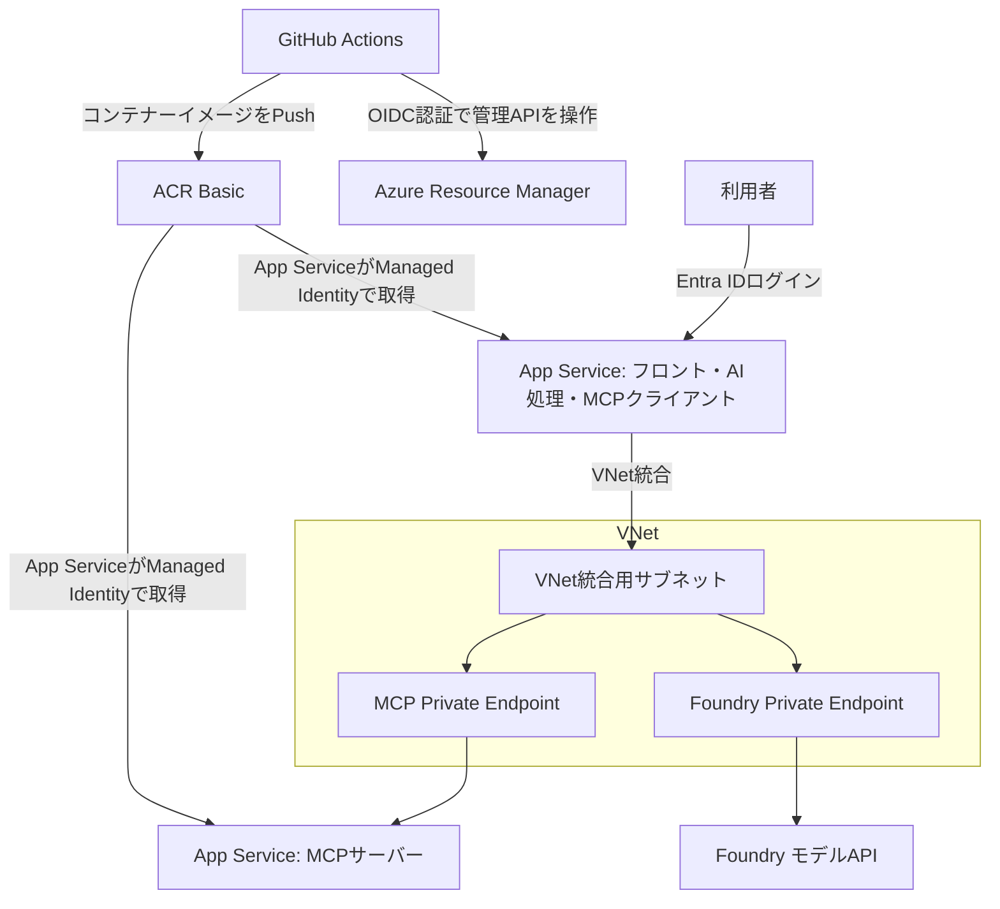

# Azure App Service・MCP・Foundry 検証要件

更新日: 2026-11-07。会話で確認した内容と、実装前の構成案を記録する。

## 目的と確定した条件

TerraformでAzure環境を構築し、GitHub Actionsによる実際のデプロイと、Entra IDで保護したAIチャット・MCP連携を検証する。コードと検証記録を新規の公開GitHubリポジトリに残し、技術ブログの材料にする。

| 項目 | 確定した内容 |
| --- | --- |
| フロント | App Serviceに画面、サーバー側AI処理、MCPクライアントを配置 |
| MCP | 別のApp Serviceに配置 |
| AI処理 | フロントがFoundryのモデルAPIを呼ぶ。Foundry Agent Serviceは利用しない |
| 利用者の認証 | Entra IDログイン必須 |
| フロントからMCPへの認証 | フロントのManaged Identityを利用。ユーザーの権限は引き継がない |
| MCPの認可 | 許可したフロントのアプリID・サービスプリンシパルに限定 |
| 公開範囲 | フロントのみ公開。MCPとFoundry APIはPrivate Endpointで接続し、公開ネットワークアクセスを無効化 |
| アプリ | Python、FastAPI、MCP SDK、シンプルなチャット画面 |
| 題材 | 架空の商品・在庫情報の検索。追加DBや実データは不要 |
| リージョン | 日本のリージョン。東日本を第一候補とする |
| Azure | 個人のサブスクリプションを利用。必要な管理権限があるとの申告。実際の権限・クォータは接続後に確認 |
| 期間と予算 | 作成から1〜2日、総額1,000円以内を目標とする |
| GitHub | 新規の公開リポジトリとGitHub Actions |
| 終了 | 検証完了後に作成したAzure環境を削除。削除忘れ対策として作成から48時間後の自動削除も設定。コードと記録は残す |

## 構成案

App ServiceそのものをVNet内に配置する構成ではない。フロントの外向き通信にVNet統合を使い、MCPとFoundryの受信にPrivate Endpointを使う。統合用とPrivate Endpoint用のサブネットを分離し、Private DNS ZoneとVNetリンクを設定する。

費用を抑えるため、2つのLinux App ServiceはB1プラン1台を共有する。アプリ・認証設定・Managed Identityは別に管理する。検証用の小規模構成であり、CPUとメモリの共有を前提とする。

モデルは東日本で利用できるツール呼び出し対応の小型モデルを選ぶ。gpt-4.1-miniを候補とし、契約の利用可否・クォータをAzure接続後に確認する。Foundryから利用するAzure OpenAIモデルAPIを対象とする。

## 認証・認可

- フロントは単一テナントのEntra IDログインを採用し、初期状態では検証者本人にアクセスを限定する案とする。個人Microsoftアカウントを利用している場合も、対象テナント内のユーザーとして認証できることを確認する。
- フロントのApp Service認証はEasy Authを使う。Managed Identityによるフェデレーションを第一候補とし、クライアントシークレットを減らす。
- フロントはMCP用とFoundry用で別の宛先向けアクセストークンを取得する。利用者のトークンをMCPへ転送しない。
- MCPはトークンの発行元・有効期限・audienceを検証し、許可した呼び出し元を制限する。ネットワークの非公開化だけを認証の代わりにしない。
- FoundryはEntra IDと最小限の推論権限で利用する。
- GitHub ActionsからAzureへはOIDCを使用する。Publish Profileや長期のAzure認証シークレットを配布しない。
- ソース、コンテナー、公開ドキュメントにトークン、State、秘密情報、個人データを含めない。

## TerraformとCI/CD

- Terraformの管理対象はApp Service、VNet、Subnet、Private Endpoint、Private DNS、Foundry・モデル、Managed Identity、必要なEntra設定・権限、ACR、State用Storage、削除に必要な設定とする。
- Stateの初期作成とGitHub OIDCの信頼設定はbootstrapとして手順化し、ワークロードのデプロイと分ける。Entraディレクトリへの権限とAzureリソースへの権限を区別する。
- PRでアプリテストとTerraformの形式・構文を検証する。Azureへ接続できる信頼済みの変更でplanを作り、mainへのマージでデプロイする。外部forkのコードにAzureの権限を渡さない。
- GitHub-hosted RunnerでコンテナーをビルドしてACRへPushし、管理API経由でApp Serviceのイメージを更新する方式を候補とする。非公開MCPのSCMへ直接接続するデプロイは前提にしない。
- ACRはBasicの認証付き公開エンドポイントを使う案とする。MCPとFoundry APIは非公開のまま維持する。追加の常設Runner、VPN、NAT Gateway、Firewall、Application Gatewayを必要としない構成を優先する。
- 自動化できるデプロイ後確認と、ブラウザで行うログイン・チャットの確認を区別する。VNet内の正の疎通確認が必要な場合は、方法と追加費用を設計に含める。
- 手動実行できる削除処理と、有効期限に基づく自動削除を用意する。削除対象は今回作成した環境に限定する。GitHubのスケジュール実行には遅延・停止の可能性があるため、削除結果も確認する。

## アプリの動作

1. 利用者がEntra IDでログインする。
2. 「ノートPCの在庫は？」などの質問を送る。
3. フロントがMCPのツール情報と質問をFoundryへ渡す。
4. モデルが要求した商品検索・在庫照会をフロントがMCP経由で実行する。
5. ツール結果をモデルに渡し、回答と呼び出したツール名を画面に表示する。

ツールは読み取り専用にする。入力長、モデル出力、ツール呼び出し回数、タイムアウトを制限する。会話の永続保存は初期範囲に含めない。

## 完了条件

| 検証 | 成功条件 |
| --- | --- |
| フロントの認証 | 未ログイン時はログインを要求し、許可した利用者だけがチャットを利用できる |
| MCPの認証・認可 | トークンなし、不正なaudience、許可されていないアプリを拒否する。正規フロントからの呼び出しは成功する |
| 非公開通信 | VNet経由でMCPとFoundry APIを呼べる。MCP・Foundryの公開アクセスは無効になっている |
| AIとMCPの連携 | モデルがMCPツールを選び、固定データと一致する在庫情報を回答する |
| CI/CD | GitHub Actionsの実行でデプロイしたアプリが実際に動作する。コードの変更が反映される |
| IaC | Terraformのplan/apply結果を確認し、再実行時に意図しない差分がない |
| 終了 | Terraform等で作成環境を削除し、App ServiceプランやPrivate Endpoint等の課金リソースが残っていないことを確認する |
| 公開記録 | 再現手順、構成図、認証フロー、検証結果、実測費用、削除手順がGitHubにあり、実測と未検証を区別している |

## 実装前に現物で確認する事項

- Azureへのサインイン、対象サブスクリプション・テナント、Entraユーザー、アプリ登録・ロール割り当ての実権限。
- 東日本でのApp Service・モデルの利用可否とクォータ。
- Easy AuthのManaged Identityフェデレーションと、採用するTerraform Providerの対応。
- コンテナー方式での非公開App Serviceへのデプロイと検証経路。
- 自動削除の開始時刻、実行結果、bootstrapリソースを含めた削除手順。

## 公式資料

- [App ServiceのVNet統合](https://learn.microsoft.com/en-us/azure/app-service/overview-vnet-integration)
- [App ServiceのPrivate Endpoint](https://learn.microsoft.com/en-us/azure/app-service/overview-private-endpoint)
- [App ServiceのEntra認証・Managed Identityフェデレーション](https://learn.microsoft.com/en-us/azure/app-service/configure-authentication-provider-aad)
- [App Serviceプランの共有](https://learn.microsoft.com/en-us/azure/app-service/overview-hosting-plans)
- [App Serviceのコンテナー・Managed IdentityでのACR取得](https://learn.microsoft.com/en-us/azure/app-service/configure-custom-container)
- [FoundryのEntra ID認証](https://learn.microsoft.com/en-us/azure/foundry/foundry-models/how-to/configure-entra-id)
- [GitHub ActionsのAzure OIDC認証](https://learn.microsoft.com/en-us/azure/developer/github/connect-from-azure-openid-connect)
